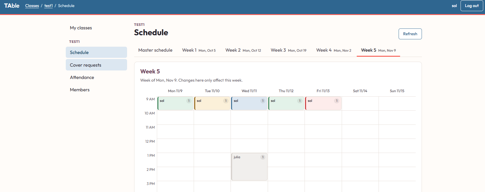
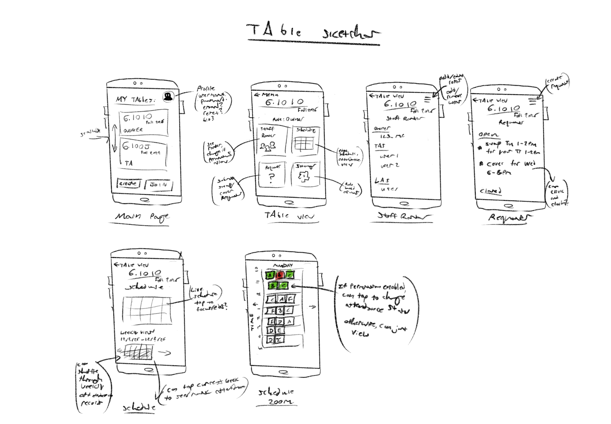
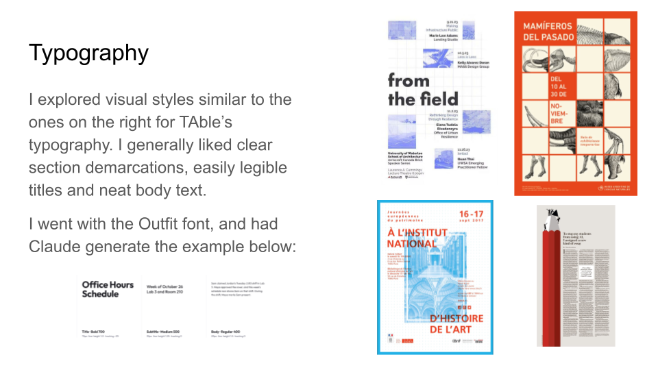
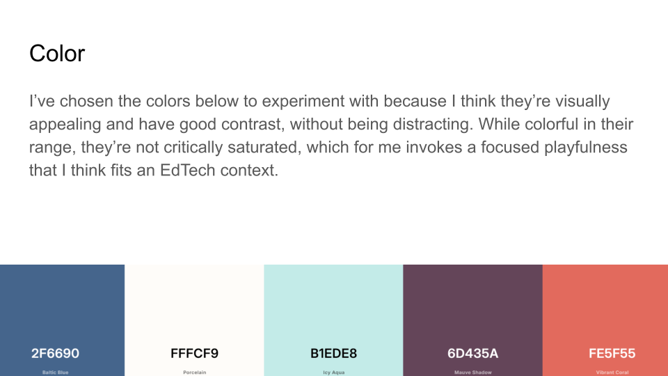

# TAble Final Design Document

## User Story

Let's say I'm a faculty member in charge of a class. I can register an account and create a class with whatever name I choose. Once other users have registered, I can invite them to join my class as a TA, LA or STAFF using their usernames. I can see the status of open invites, and withdraw them if I want. Once they accept, any TA and STAFF can set up a master schedule, assign people to its shifts, and publish weekly copies. LAs have more limited abilities, but also can use the tool to make their lives easier. For example, LA 1 can request a cover for their shift, LA 2 can claim it, and a TA or STAFF member can approve it. That week's schedule then shows LA 2 scheduled for the covered shift, and the request would be marked as approved. During the shift, a TA or STAFF member can mark LAs present, and LAs can see their current attendance record for the class. Cover requests, statuses, etc. are shown on a convenient dashboard. Attendance can be easily marked from a separate attendance dashboard, or on each schedule copy (both update live). TAs and STAFF also have an analytics dashboard for viewing attendance for the class, or any particular member on staff, at a glance.

## Changes from P1 Concept Design

The concepts from P1 ([2a3bea9](https://github.com/JMFortt/6.1040-personal-project-jmfortt/blob/2a3bea9/design/section_3.md)) changed more than I had expected, but less in large sweeping changes and more in small tweaks:

- ([d7707a8](https://github.com/JMFortt/6.1040-personal-project-jmfortt/commit/d7707a8)) Swapped almost immediately to preset roles with preset permissions (from previously configurable ones). This simplified the RoleBasedAccessing concept, and made it more generic as a bonus

- ([ab384b5](https://github.com/JMFortt/6.1040-personal-project-jmfortt/tree/ab384b5/implementation/design/concepts)) I added a sessioning concept to be able to stay logged in as users did things on the site

- ([5adfedf](https://github.com/JMFortt/6.1040-personal-project-jmfortt/commit/5adfedf)) Added the ability to make schedule copies, which required a significant change to ShiftScheduling

- ([1982ce8](https://github.com/JMFortt/6.1040-personal-project-jmfortt/commit/1982ce8), [a10c162](https://github.com/JMFortt/6.1040-personal-project-jmfortt/commit/a10c162), [f856d22](https://github.com/JMFortt/6.1040-personal-project-jmfortt/commit/f856d22)) Added member management (changing roles, removing members, and leaving a class yourself), clearing an attendance mark, and deleting classes, weeks, and shifts

- Ultimately dropped shift swapping, since that can be done with sequential covers and would otherwise need a messaging feature of some kind

- ([a067b70](https://github.com/JMFortt/6.1040-personal-project-jmfortt/commit/a067b70)) Added the ability to withdraw class invites

- ([961c3b2](https://github.com/JMFortt/6.1040-personal-project-jmfortt/commit/961c3b2)) Added EXCUSED as a possible attendance marker option

- ([961c3b2](https://github.com/JMFortt/6.1040-personal-project-jmfortt/commit/961c3b2)) Added a way to change shift capacity after creation, as it was annoying to have to make an entirely new shift after every unexpected capacity increase

## Changes from P3 Visual design

The visual design I chose in P3 I mostly decided to stick with, though I made more minor changes to make the interface more intuitive. As you can see from the visual design study and wireframe sketch images below, the original ideas I had for the interface are mostly what I stuck with (though the wireframe structure changed significantly):

The most significant changes I made to the visual design were smaller changes to make the site more understandable, readable, and easy to use.

- I removed some of the visual clutter in the top nav bar

- I removed unnecessary information on the schedule grid slots

- I made the colors on the schedule more intuitive (removed role colors, which were unneeded, and added clear colors indicating attendance status)

If I work on this project further post-project timeline, I may go back and give the visuals a more distinctive visual direction. Although I went generic and muted-colorful on purpose initially for readability and general ease-of-use, I'm curious how a more distinctive visual aesthetic would affect the intuitiveness of the site.

## Video

You can watch the demo video [here](https://drive.google.com/file/d/1dhuYwmqtcisRtqbDnhdZtpTsm5VY9j_E/view?usp=sharing).
